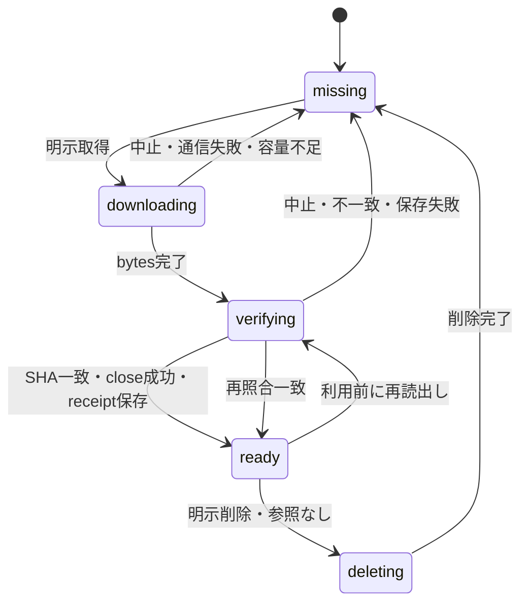

# モデルmanifestと保存（D05設計案）

2026-11-02更新。A10は計測中、A11は未判定。本資料は実装仕様案であり、候補モデルの採用やcache実装の完了を示さない。
[利用者向け状態](preparation-and-recovery.md)と[所有権](modules-and-ownership.md)に従う。

再利用方針は[ADR002](adr-002-reuse-ml-libraries.md)へ更新した。
Transformers.jsの標準cache/取得機能を先に評価する。以下のOPFS配置・commit・lock方式は比較案であり、
独自engineの採用決定ではない。SHA整合性・中止・容量不足・版管理の機能要求は保持する。
現在のlibrary API境界と不足分は[取得/cache/通信の方針](library-resource-policy.md)に整理した。以下の「現行候補」と「旧OPFS比較案」を区別する。

## 配布単位と信頼境界

アプリbuildにmanifestを同梱し、release IDとそのSHAを固定する。実行中にlatest manifestを取得して置換しない。
manifestはモデルの元repository/revision/weights SHA、変換物SHA、精度、opset、入出力、runtime版、
必要features/limits、CPU併用方針、LICENSE/NOTICEを保持する。既存models.candidate.jsonは調査記録であり、
そのまま本番manifestとして読まない。A11採用後に検証済み候補から生成する。

各ファイルに役割、相対名、HTTPS URL、整数bytes、64桁小文字SHA256を要求する。
URLはbuildで固定する配信origin配下に限定し、redirect後も同じ許可originを要求する。
HTTP非成功、opaque response、過大/不足bytes、SHA不一致を拒否する。
Content-Lengthは進捗の真値にせず、manifest bytesを上限とする。超過chunkを保存しない。
external data名は単一basename、重複なし、スラッシュ・backslash・`.`/`..`・URLを拒否し、
ONNX内の参照名との一致も公開前検証する。Workerへはこの名前と照合済みbytesだけ渡す。
モデルから任意network取得を許さない。

ORT JSはbundleへ固定し、対応WASMもmanifestのruntime assetとしてbytes/SHAを固定する。
JS/WASM/モデルの組合せをreleaseで固定し、保存済み旧WASMを新JSと組み合わせない。
WASMの配信・初期化方法はD09で検証し、未検証のBlob URL互換性を前提にしない。

## 2026-11-02 通常HTTPでのruntime取得・保存の観測

Linux Chrome153の別port実HTTP（routingなし）で、固定ORT1.31.1の同origin MJS/別origin WASM28,747,738byteをWorkerから取得した。真のACAO欠落/別origin指定はfetch拒否、connect-srcのorigin未許可はserver到達0、wasm-unsafe-evalなしはSHA照合後の初期化で拒否。許可時は公式runtime初期化とwebgpuInit exportの存在を確認した。GPU adapter要求/session/モデル推論は0。これは診断Workerの通信と初期化であり、HR/Matte本体・R2 edge・HTTPS・Windowsの受入ではない。

同一URL/immutable headerでも、一時contextではfresh WorkerのWASM再取得を観測し、no-refetch条件は不合格として保持した。専用一時persistent profileの既定cache（容量flag変更なし）では、初回MJS/WASM各1要求、その後のfresh Workerとbrowser終了→同profile再起動後はいずれもruntime再要求0で初期化成功。profile条件による保持差の観測であり、原因を特定のcache容量へ断定しない。Chromiumは[incognitoのmemory cacheと通常profileのdisk cacheを分ける](https://chromium.googlesource.com/chromium/src/+/bc09aaf07373634a56bef56b7876df847d7a5436/net/disk_cache/)が、HTTP headerだけで保存・再利用を保証しない。

model CacheStorageとruntime HTTP cacheは別契約のまま維持する。モデルcacheがreadyでもruntimeをoffline-readyとは表示せず、転送費用/準備時間は対象profileで確認できるまでWASM反復取得を含める。独自runtime cacheやbrowser cache容量の拡大を既定にしない。restart検証はserver onlineであり、offline起動/eviction/別tab/更新・rollbackは未受入。証拠: [実HTTPのruntime/cache検証](validation/2026-11-02-real-http-cross-origin-runtime-cache.json)。[CSPのWASM許可](https://developer.mozilla.org/en-US/docs/Web/HTTP/Reference/Headers/Content-Security-Policy/script-src)と[CORS](https://developer.mozilla.org/en-US/docs/Web/HTTP/Guides/CORS)に従い、公開unconfigured版のCSPをここでは緩和しない。

2026-11-02の後続本体確認では、固定Lite FP32/明示WASM CPUを初回通常HTTPで取得・照合・保存してPNGを作成した後、同task専用profileのbrowserを再起動し、model/config/ORT runtimeのHTTP再要求0で透過PNGを再生成した。透過PNGは初回と全byte一致、既存resource-policyによるcached Responseのstream bytes/SHA照合経路を通った。背景色変更は再推論せず、同browserでcrop/A4 PNG/PDFまで保存・独立画素検査を完遂。これは一素材のCPU候補であり、HR/Matte・全面offline・eviction/容量/版競合/長期・production R2の受入ではない。最後の通信断確認は作成済みPDFの再保存だけに限定する。証拠: [初回本体HTTP](validation/2026-11-02-main-lite-cpu-real-http.json)、[再起動cacheとA4通し](validation/2026-11-02-main-cpu-warm-full-chain.json)。

## 現行候補: library取得＋標準CacheStorage

private本体ではTransformers.jsのenv.fetch/customCacheと[resource-policy](../../tools/browser-library-adapter/resource-policy.mjs)を使用し、標準match/putへ委譲する。独自OPFS file配置・receipt・rename/commit・download queueは既定にしない。公開版はまだモデル未配布であり、ここで全cache受入を完了とはしない。

| 境界 | 現在の契約 |
|---|---|
| key/版 | 固定release namespace＋完全な資源URL。SHA/bytesは内容照合用で、全namespaceを跨ぐ物理SHA重複排除を保証しない |
| cache read | matchしたResponseもstream完了までbytes/SHA再照合。metadata一覧の件数だけをready証拠にしない |
| network read | 固定GET、credentials omit、redirect error、許可URLだけ。manifest bytesを上限に増分SHA照合。写真Blob/RGB/alphaをこの入口へ渡さない |
| 保存 | native cache.putへ照合streamを渡し、body消費・SHA一致・put完了後のみstored。libraryが未保存handleを返してもprepared-modelが全必須fileの状態を確認して拒否/解放 |
| 中断/失敗 | AbortSignalをstreamへ伝え、固定codeで失敗させる。部分/不正fileを採用しない。native putの内部実装を独自receiptで置換しない。再利用時にも内容照合する |
| 破損 | 自動で別版へfallbackせず失敗。現行UIは明示削除→同固定版の再実行を案内。SHA不一致を保存済み成功にしない |
| 確認/削除 | 手動確認/削除は選択した背景＋補正のnamespace/URL scope。開始前の必要量だけは補正ON/OFF・一致mask再利用に応じ背景/補正/両方/モデル不要（補正OFFで一致maskあり）を選ぶ。確認は件数metadata、削除はnative Cache.delete。別構成との共有資源/別タブでの再保存を説明。写真・PNGは削除しない |
| 同時利用 | 同一ページのimageWorkGateで画像処理/削除を調停。別タブglobal lockや原子的release更新は未実装/未受入。Web Locks非対応を理由に手動機能を拒否しない |
| 容量/通信 | 構成別model bytesを表示。明示確認で未保存URL分の取得bytesと標準StorageManagerの空き見積りを表示（内容検証/保存成功の保証ではない、RAM/VRAMと区別）。初回準備panelと明示開始確認を接続済み。端末全対応/実quota表示/eviction/全crash検証は未完。model CacheStorageとORT WASMのHTTP cacheは別。完全offlineを保証しない |

小fixtureのread/write/hash/Abort/quota、private本体の破損削除→再取得、Chrome quota overrideから復帰した範囲と、未確認の実disk枯渇/別タブ/eviction/通常配信を分ける。出典と範囲はvalidation/2026-11-02-cache-design-integration.json。

## D11: 初期公開の起動・オフライン・更新方針（2026-11-03）

初期公開はオンライン起動を前提とし、アプリ独自のService Workerを採用しない。
現実装の標準HTTP配信・CacheStorage・明示実行を維持する判断であり、完全offline対応を実装済みとはしない。
`requirements.md`の完全offlineは従来から条件付き・未確定であり、モデル保存だけで保証しない要件を具体化する。
写真の端末内処理は維持し、オンライン起動を写真の送信と混同しない。

| 場面 | 契約と証拠の範囲 |
|---|---|
| 初回・再起動・再読込 | HTML/JS/CSS/Worker等の取得に接続が必要。HTTP cacheの保持・eviction・private modeはブラウザに依存し、offline起動成功を保証しない |
| モデル保存済み | 同じ固定namespace/URLの保存物もbytes/SHAを再照合する。取得見積り0MiBはアプリ/ORT/Workerまでofflineで揃う意味ではない |
| 開いている画面の作成済み保存 | main12のChromium/WebKitで準備済みPDFを通信断後に再保存しbyte一致を確認。保存済みBlobの同一ページ内再利用に限り、新規作成・新Worker・再起動のoffline保証へ拡張しない |
| 通信失敗・復旧 | 写真/設定を保持し、明示的に再試行する。WebKitのモデルGET遮断→同画面再試行→印刷保存は確認済み。HTML起動不能ではこの画面内案内自体を表示できない |
| ページの離脱・再読込 | 写真/派生物はページ内メモリのみ。beforeunloadの警告はブラウザが表示を抑制する場合があり、保存保証にしない。pagehideでリンクや一時状態を解放する。必要な出力を先に端末へ保存する |
| アプリ更新 | 実行中の固定manifestをlatest取得で差し替えない。新しい版を使うためにページを再読込し、その際写真が消えることを説明する。自動再読込・処理中の版切替・SWによる強制更新を追加しない |
| 旧タブとモデル削除 | 旧タブは自身の固定記述を使う。現用namespace/URLの明示削除は他構成・別タブと共有する資源にも影響し、別タブが再保存することがある。global lock/原子的release更新/旧版自動GCは保証しない |
| 公開版の復帰 | 旧dist/inventoryを照合し、モデル/runtime/NOTICE/配信URLと組で同じ版へ戻す。ローカルinventoryの照合はあるが、Pages deployment ID・R2・既存旧タブとの復帰は実配信未確認 |

この方針はSW実装や独自アプリcache engineを追加せず、検証済みの狭いoffline操作と未保証の起動範囲を分ける。
再起動後の完全offline作業が必要になった場合は、アプリ資産・runtime・Workerの固定保存、更新時の旧タブ、
eviction/容量不足と復帰までを一緒に設計・検証してから再検討する。モデルcacheだけを拡張して代用しない。

実装参照: `web/src/Root.tsx`、`App.tsx`、`background/BackgroundEditor.tsx`、`export/useCropSave.ts`、
`tools/browser-library-adapter/preparation-source.mjs`、`resource-policy.mjs`、`model-cache-actions.mjs`。
実行証拠: [現WebKitの通し保存](validation/2026-11-03-webkit-current-full-modnet-print-chain.json)、
[取得失敗からの復帰](validation/2026-11-03-webkit-model-fetch-recovery.json)、
[Chromium再起動warm保存](validation/2026-11-03-linux-updated-browser-warm-chain.json)。
2026-11-03追補: main12のChromium155/新規context2tabで、AのMODNet処理完了後にBのUIから共有モデル保存2fileを削除（2/2→0/2）。両tabの写真、Aの結果/link/保存byteを保持し、Bのモデル/config各1GET→実推論→同PNG、2/2へ復旧、最後のA保存も一致。これはidle後の削除で、取得/推論中の削除・同時更新・別版・WebKit/iOSの保証ではない。[別タブ削除と再取得](validation/2026-11-03-cross-tab-model-delete-recovery.json)。

さらに同Chromiumで、AのモデルONNX GETを応答前に待機させ、configだけ保存済み1/2の時点でBのUIから削除→0/2、Aがbusy/未確定のままを確認。GET再開後Aの推論/PNGは基準byte一致し、modelのみ再保存1/2。Bは不足config1GETだけで実推論/同PNGへ到達し2/2へ戻る。削除後の別tab再保存と部分cacheの再利用を確認した一例であり、response途中/driver/GPU中の削除・全競合を閉じない。[取得待機中の削除](validation/2026-11-03-cross-tab-delete-during-fetch.json)。

D09/D11/F06の実origin・旧タブ/更新競合・eviction・公開復帰は未完で、ここでは受入状態を完了へ変更しない。

旧OPFS比較案（未採用の実装案。以下は現行必須APIではない）

## 保存方式と容量

主対象ChromeではOPFSへstreamで保存する。モデル専用Workerで増分SHA256を計算し、
fetch chunkを逐次書込みする。全dataをWeb Crypto用に複製する方法をdownload経路で使わない。
増分SHA実装はE04で固定・既知vector/分割chunk/大容量streamを検証する。未実装のhashを検証済みと表示しない。
OPFSやWeb Locksが利用不可なら初期版の背景機能は準備不可として案内し、手動crop/印刷は継続可能にする。
「保存せず1回利用」は初期版に含めず、保存失敗後に巨大bufferを黙って保持しない。

保存領域はアプリ固有prefix以下。写真は保存しない。
内容キーはSHA256。manifest側の複数参照は同じ物理fileを共有できるが、UIは機能単位で表示する。
同時downloadは1file、同時モデル取得操作は1件。HRと補正を並列取得しない。

開始前にestimateのquota/usageと未保存bytesを表示する。見積りに加えて現在の一時file分と
記録領域の余裕を考慮するが、保存成功は保証しない。persist要求の成否を保存保証として表示しない。
既存の検証済みfileを再取得で複製しない。OPFSからの読出し時には1fileずつSHAを再照合し、
照合後に必要なArrayBufferだけ推論Workerへtransferする。最大のexternal data読出しは約448MBなので、
保存領域と読出し時RAM、ORT/GPUメモリは別に計測する（A10/F05）。

## 状態とcommit

物理fileは`objects/<sha>.bin`、一時fileは`pending/<operationId>.part`、
receiptは`receipts/<sha>.json`とする。receiptにはschema、SHA、bytesのみを記録する。
file名へURLやモデル名、写真名を入れない。作業prefix以外を列挙・削除しない。

commitは(1)stream終了と実bytes/SHA照合、(2)writer close成功、(3)内容file確定、(4)receipt保存。
OPFS renameの利用可能性を前提にせず、E04ではpending fileから内容fileへのstream copyも許す。
この場合、一時的に最大fileの2倍容量を要するので見積りへ加算し、copy完了後に一時fileを消す。
receiptだけを信用せず、利用前に実fileのbytes/SHAを再検証する。
途中終了でreceiptが壊れた場合は未準備扱い。残ったfileは照合後に再利用できるが、欠落fileをreadyにしない。
クラッシュ時のpendingは次回同じlock取得後に掃除する。再開Rangeは初期版では使わず、そのfileを最初から取得する。

取得中に中止した場合はAbortControllerを中断しwriterを閉じ、pendingと不完全な内容fileを削除する。
削除失敗は未準備状態のまま掃除対象として記録し、再取得時の容量に含める。
完了済みの別fileは保持する。中止とcommitが競合した場合はoperation IDの有効性をcommit直前にも照合し、
無効操作の完了で自動推論を開始しない。cacheだけ残った場合も写真/設定キーの一致を別途確認する。

## 複数タブ、削除、更新

Web Locksのアプリ固有lockを取得・検証・削除に使用し、別タブの更新と競合させない。
待機中は「別の画面でモデルを準備しています」と中止操作を表示する。
lock待ち中のAbortで処理を始めない。broadcast通知はUI再確認の契機だけで、readyの証拠にしない。
推論へ必要bytesを転送し終えた後は保存fileのlockを解放できる。UIの削除要求は自身のsession終了後に行う。
別タブが既に持つRAM/GPU sessionはcache削除では破壊されず、通知で勝手にterminateしない。

更新は新しいアプリreleaseの再読込後、必要bytesを表示して明示取得する。
旧版のfileは自動削除しない。容量不足時に旧版一覧・bytes・再取得が必要になる説明を出し、利用者が選んで削除する。
共有SHAは残す版からの参照がなくなったときだけ削除する。古いタブのmanifestを新しいタブが書換えない。
release receiptを保存し、削除対象の一覧とbytesは同じlock内で再計算してから削除する。
アプリ更新時のService Worker/再読込競合はD11で確定する。

## エラーと検証項目

通信失敗は同じ固定版への明示再試行。SHA不一致は該当fileを不採用とし、現行候補ではUIからの明示削除→再取得で回復する。自動retryしない。
quota失敗は同じfileの再取得を自動開始せず、モデル一覧の削除操作へ案内する。
保存領域がブラウザから消えた場合は未取得へ戻す。取得済みの表示を永続保証にしない。
任意例外文字列・URL query・写真情報を診断へ含めず、固定codeとartifact SHA/bytes/phaseのみ記録する。

E04/F01/F06では採用する保存方式に対し、stream中断、末尾不足/超過、SHA破損、保存失敗/quota、
タブ終了と再読込、別タブ同時取得/削除、release共有/更新、保存領域消失、古い操作完了と設定変更を確認する。
OPFS固有のwriter close/receipt/commit copyはその方式を採用した場合の検証で、現行CacheStorageへ同じ実装を要求しない。mock成功だけで永続cache受入を完了にしない。

D05はA10のcold/warm・容量/RAM計測とD09のruntime取得経路の確認後に確定する。

### PoC実装で確認した範囲

2026-10-31、独立診断ページに増分SHAとOPFS逐次保存/再読出しを実装し、HR約457MBの両fileを
実ChromeでSHA照合した（[記録](validation/2026-10-31-birefnet-opfs-cache.json)）。
これはE04の本番cache実装やD05の全状態検証ではない。PoCは専用namespaceのみで、
commit copy/receipt crash recovery、複数タブ、版削除、quota失敗など本仕様の全機能はまだない。
増分SHAは既知vector/境界/分割・native cryptoとの比較を確認した独立実装で、
今後本体へ採用する際にもcodeを固定して本番経路で検証する。
OPFS sync access handleのWorker限定条件は[Chrome公式資料](https://developer.chrome.com/docs/capabilities/web-apis/file-system-access)を確認。

### 2026-11-02: 選択候補のlicense coverage

private max4の9部品（HR/Matte、モデルWorker群、ORT、前景、thumbnail/crop/HR resize、OpenCV/SDK）を実artifact SHAと捕捉全文へ対応付けた。ViTMatteのweight card Apache2とcode MITは別欄。Foregroundのrembg MIT漏れを修正し、新private app stage-group4-notices-main-01へ統合、同runtime config/model/実行asset SHAを維持。以前のレビューreceiptは旧NOTICEを固定した履歴であり置換しない。公開immutable releaseでは更新notice自体のdigestもversionと結合し、同URLを上書きしない。対応表はvalidation/2026-11-02-selected-runtime-notice-coverage.json。対応表/同梱は最終配布承認や全transitive適用性の証明ではない。

### 2026-11-03: CPU3段Matteのprepare cacheを実browser再起動で確認

現CPU variantの既存model Worker/prepare/dispose protocolだけを専用pageで実行し、4資源408,618,148Bをresource-policyのbytes/SHA検証とCacheStorage保存へ通した。coldモデルHTTP4件/prepare+dispose約2.440秒。監視unitでbrowser/server終了を確認し、profile約412MBを変更せず保持。新browser processを同profileで起動し同prepare/disposeを実行、warmモデルHTTP0件/約2.610秒で成功。既存serverのモデル応答既定no-store、--cache-runtime未使用で、単なるUI件数確認と内容検証を分けた。

専用probeはresource-stateのmetadataだけ保存し、個別cacheVerified flagsは保存していない。正常prepared/既存検証経路/モデルHTTP0が記録した証拠。写真input/inferを送らず、warm全HR＋Matte推論やPNG一致の受入には拡張しない。UI inspectCache自体は登録件数であり内容SHAを検証しない既存仕様を維持する。

cold最大RSS1,718,505,472B、warm最大RSS1,490,931,712B、監視停止なし。profile412,430,336Bを削除、必要model/payload/evidence保持、browser session/proxy/tunnel終了、container停止/Gufo0/GPU client0/baseline復帰。OS再起動/eviction/quota/他端末/Pages-R2は未受入。証拠: `image-studio/docs/browser/validation/2026-11-03-cpu-matte-persistent-prepare-cache.json`（model-manifest-and-cache内ではvalidation/同名）。
