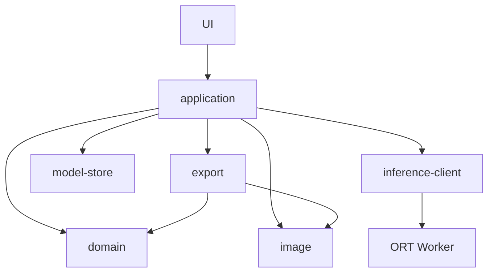

# モジュール・データ所有権・Worker通信（D01〜D03）

2026-11-04更新。先頭は現行の変更先。日付付きの後続節は、その時点の実装・検証履歴として読む。前提: ADR001、B05の依存キーと失効表。
[型契約](worker-contract.ts)は設計資料でありE01/E03実装ではない。
推論内部の演算配置・メモリ量・モデル採否はA11/D04で確定する。

状態・event・guard・保存可能条件の契約は[状態機械](state-machine.md)を正本とする。
画面route/表示phaseだけを処理の終了・保存可否と同一視しない。

## 現在の変更先（G03/G04）

| 変更すること | 所有する実ファイル・手順 |
|---|---|
| 通常入口・画面遷移・背景→crop→printの引き渡し | `web/src/main.tsx`、`Root.tsx`。`main.tsx`は固定 `__BACKGROUND_RELEASE__` がある場合に `background/releaseRuntime.ts` を読み、`Root`へ渡す |
| 背景UI・モデル別注意・写真/結果の寿命 | `web/src/background/BackgroundEditor.tsx`、`runtime.ts`、`browserSession.ts`、`session.mjs`。表示metadataと演算backendを分離し、操作の共通同期guardを維持 |
| crop/用紙保存・PNG/PDFの失効 | `web/src/App.tsx`、`export/`。ブラウザ側の共有契約・演算は `tools/browser-library-adapter/` を再利用 |
| 固定入力の検査・Worker生成・公開配布の検査 | `web/scripts/build.mjs`、`background-release.mjs`、`check-dist.mjs`と `tools/build_browser_release.mjs`、`verify_browser_release_bindings.mjs`。標準 `web/background-release/` は作業repoで未採用。設定なしは手動版、不正設定は失敗 |
| Workerの固定依存・資産/NOTICE結合 | `tools/browser-build/`、`browser-build-dependencies.mjs`、各Worker builder。生成物・node_modulesを実装ソースとして編集しない |
| 非公開の計測・native比較 | `web/src/localValidation.tsx`、`localValidationTrace.mjs`、`tools/browser-webgpu-poc/`と観測/比較tool。通常入口へ観測globalを混入させない |
| 開発用変換・検証 | `tools/`。ブラウザ用ONNX/WASMと参照生成のみ。旧Pythonサーバー・Docker/ExecuTorch実行系は廃止 |

公開配布は `web/dist/` を検査した静的成果物だけ。`tools/`というdirectory名だけで
実行コードを判別しない。adapterはブラウザ実行、builder/比較toolは開発時、固定npm
projectは生成時の依存を所有する。新packageやdirectory移動は、名前の統一だけを理由に増やさない。

現source14ペア（sourceId `7677a09f…` / artifactId `c2bd4848…`）の四構成通常保存、
HR CPU/GPU各1件のnative通しとGPU取消後の補正再試行は確認済み。
[四構成](validation/2026-11-04-source14-four-choice-native.json)、
[CPU通し](validation/2026-11-04-source14-cpu-full-journey.json)、
[GPU通し](validation/2026-11-04-source14-gpu-full-journey.json)、
[GPU取消](validation/2026-11-04-source14-gpu-matte-cancel-retry.json)へ対応付ける。
旧日付の「mainは背景を接続しない」「現CPUは未確認」等を現状態へ転用しない。
匿名配信・実端末・全競合・一般品質・最終G07受入は別に残す。

## 状態契約に基づくModule設計判断（2026-11-04）

現行のseamを維持する。新しい統合store、状態管理library、共通editor wrapperは追加しない。
状態機械の積を一つのenumへ移しても、写真・出力・Workerの異なる寿命は消えず、
各Moduleが所有するrevisionや停止手順を呼出側へ漏らすためである。

| Module / seam | 呼出側が知るInterface | Implementationへ閉じ込める責務 / 契約 |
|---|---|---|
| `Root` / `EditorHandle`・`PhotoTransfer` | 写真の有無、明示import、作成済み写真と`isCurrent()`。import成功は最初の可視表示成功とは別 | 置換同意・navigation epoch。可視表示の検証とrollbackは受取editorが所有（I01/I02/I08/I10） |
| `BackgroundEditor` / `BackgroundRuntime` | モデル別metadata、cache見積り、decode、session生成 | 同意・表示・session ownerとUI epochの照合。旧sessionの通知/取消結果を現在へ反映しない（I05） |
| `createBackgroundSession` | 写真/model/refine設定、run/save/cancel/close、状態snapshot。cancel/closeはPromiseの結果まで確認 | 写真/mask/resultの所有、revision、推論とexportの調停。mask保持条件と最終結果の有効性を分離（I03〜I07/I12） |
| `App` / 写真入力と`useCropSave` | 可視表示済み写真、出力key、origin predicate、prepare/cancel/保存開始 | Appが初表示前の旧写真を保持しrollback。保存Moduleは各slotのkey/URL所有と開始時の再検査を所有（I02/I08/I09） |
| `createWorkerGate` / lease | 取得可否、親lease、子gate、終了確認後のrelease | 全editor共通の占有、親のrelease要求後も子終了待ち、失敗時block、旧leaseの隔離（I06/I07/I11） |

session、export、gateは、削除すると資源所有・停止・失効処理が複数の呼出側へ戻るためDepthを持つ。
UI epochとsession revisionは同じ値へ統合しない。前者は同意/decode/表示callback、後者は演算入力と結果を識別する。
実GPU/CPUと制御されたtest用Adapterは既存factoryのseamを使い、新しい単一実装Interfaceを重ねない。

この判断は実装責務の照合であり公開承認ではない。変更影響は
[source14照合](validation/2026-11-04-source14-runtime-change-impact.json)、
異常系とnativeの区別は[状態機械](state-machine.md)を参照する。
source14固定後の本節は作業資料の追記で、固定済みarchiveに含まれると主張しない。
匿名HF/Pages、停止不能を含む実環境の全競合、対象実端末、人の操作・実印刷、最終配布条件は未受入のまま。

## 責務と依存（D01）

論理的な責務と依存方向。以下は層の区分であり、同名directoryへの移動を要求しない。現行の実ファイル対応は末尾の統合照合を参照。

| 層 | 責務 | 依存できる層 |
|---|---|---|
| ui/ | React画面、入力、フォーカス、進捗/エラー表示 | application、domainの読取型 |
| application/ | 編集操作、job調停、依存キー照合、遷移、資源解放の調整 | domain、image、inference-client、model-store、export |
| domain/ | 写真/設定/revision、失効規則、座標・寸法の純粋計算 | 共有型だけ。React/ORT/DOM/fetchに依存しない |
| image/ | decode、正規化、補間、trimap、前景推定、合成・preview | 共有型と画像演算backend。推論結果を捏造しない |
| inference/ | Worker client、通信型、専用Worker内のORT | 共有型。WorkerからUI/applicationへ逆importしない |
| model-store/ | 固定manifest検証、download、SHA照合、cache | 共有型、ブラウザstorage。画像assetへのアクセスなし |
| export/ | 同revisionのPNG/PDF、DPI、Blob URL管理 | image、domain寸法、共有型。download時に再推論しない |

model-storeは固定manifest、資源取得policy、cache namespace、保存状態の所有境界である。
取得実行は既存library/fetch/cacheへ委譲する。再利用候補ではWorkerがこのpolicyの下で固定資源を取得する。
任意URLのfetchを許可せず、ORT自身のWASM asset取得origin/経路はD09で別に固定・検証する。
以前の「mainでモデル全量取得→全byte転送」は比較経路として保持し、本番の既定とはしない。
画像・結果の外向き通信は設けない。前処理をWorkerへ移す場合も共有型を介し、UI依存を入れない。

## データと所有権（D02）

domain sessionには`ImageAsset`参照を置き、画素配列・Blob・GPU tensorをReact stateへ複製しない。
applicationのallocation registryがasset IDから実体を管理する。
元画像は方向補正済みRGBと、必要な元寸法を所有し、表示previewを原本と区別する。
背景用2000px制限は派生入力にのみ適用し、直接crop/印刷の元画像を暗黙に縮小しない。

| 資源 | 所有者 | 寿命・解放 |
|---|---|---|
| decode中の候補Blob/ImageBitmap | image読込job | commit成功まで旧原本を保持。失敗/破棄時に候補を解放 |
| 原本画素 | registry | 新写真確定/セッション終了。派生参照だけで原本を上書きしない |
| Worker入力 | 転送前application、転送後Worker | 原本から作る必要分のコピーだけtransfer。detached bufferを元画像に使わない |
| ORT model/session/tensor | Worker | run後tensor解放。モデル切替時session release。中止時Worker終了も解放境界 |
| Worker出力alpha | 転送前Worker、転送後application | validならregistry登録。不一致なら参照を捨てる。新写真/推論変更でrelease |
| 合成/crop/用紙画像 | registry | 依存キーを保持。staleは保存不可。置換時に不要な旧実体をrelease |
| preview ImageBitmap | ui表示adapter | 元artifact revision変更/画面unmountでclose。原本をcloseしない |
| export Blob/URL | export job | 設定失効・置換・セッション終了でURL revoke。download開始直後の即revokeは避け、実装でブラウザ動作確認 |
| モデルcache | model-store | 写真寿命と独立。版削除/破損隔離/更新方針はD05へ |

共有下流参照はregistryで参照数または明示所有者集合を管理する。画面unmountだけでsession画像を破棄しない。
写真を戻る履歴から復元するための画素コピーは作らない。メモリ保持だけで再読込復元はしない。
crop/printには入力のoriginと依存キーを持たせ、別upload由来なら無関係な上流変更から独立させる。

## Worker通信（D03）

モデルWorkerの全要求と全応答に`workerId`と`jobId`。推論の要求・結果に
`inputId/inferenceRevision/modelVersion`も付ける。Worker再作成ごとにworker IDを変更する。
main側は現在worker/current job/入力/設定/model版の一致をすべて確認してから採用する。
`progress/error`も古いworker/jobなら表示しない。Workerの捕捉不能errorも所属workerに結びつける。

`prepare`はモデルversion・種別と判別可能なsourceを持つ。
`verified-bytes`は既検証fileを転送する比較経路、`library-resources`は固定release/cache namespace/manifest資源を渡す候補。
後者でmodel bytesをmainにも同時取得しない。資源descriptorはアプリの固定manifestから生成し、
Worker側もversion/roleと完全一致を検証する。未知URL、余分なfile、別版、任意namespaceを拒否する。
型のurl:stringだけを根拠に安全と判断せず、実行時policyを必須にする。
`infer`はRGBと必要時のHR alpha、
`result`はalpha plane。width/height/layoutとbuffer長を両端で検証し、
RGBなら `width*height*3`、alphaなら `width*height` bytesの一致を要求する。
transfer listには各ArrayBufferを一度だけ入れる。要求送信後のbuffer再利用は禁止。
モデルのexternal data名はmanifest内の名前に限定し、パストラバーサルや任意fetchを許可しない。

同時実行は1job。準備中/実行中は次の要求をqueueへ積まず、最新操作で無効化・再調停する。
取得中cancelは取得policyのAbortControllerへ伝える。まず所属を論理失効し、対応Workerへ固定cancel要求を送る。
ORT/WASM呼出し中の即時応答は仮定せず、その呼出しと所有資源の解放が終わった同job/workerのACKを待ち、
その後にterminateしてからgateを解放する。native terminateのreturnだけを同期計算の終了証拠にしない。
ACK timeout/error/終了失敗はgateをblockedにし、新jobを受け付けない。未知protocolをlegacyへ黙ってfallbackしない。
明示したlegacy経路は比較用として区別し、同じ物理終了保証を与えない。遅延messageは所属照合で破棄する。
実stage/Matteの中止と全競合の受入はF01に残る。

進捗は工程名と経過時間で、推論の残時間や割合を推測しない。
モデルエラーは固定code/retryable、pixelエラーは固定codeだけをUIへ渡し、画像や任意例外文字列をdiagnosticへ直列化しない。
error→日本語メッセージの対応はB10、完全な文言集はB12で確定する。
初期公開に顔モデル要求はない。D04のモデル逐次session設計で、HRと補正の切替方法を確定する。

## 再利用方針に伴う再確認（2026-11-01）

D01/D03を進行中へ戻し、取得実行場所と保存状態通知の矛盾を修正した。
resource-state応答はSHA/bytes/固定状態だけを持ち、URL/画像名/例外本文を含めない。
mainは既存worker/job/modelVersion照合を行い、遅延通知を捨てる。
必須fileの保存・照合が揃う前にpreparedとしない。quotaでlibraryがhandleを返した場合は
prepareStoredModelで解放後に失敗させ、保存状態通知をUIの原因別復旧へ使う。
中止は旧操作を失効してWorker終了する。終了後のcache再監査も必要で、
旧resource-stateのstored値を次Workerの準備済み証拠にしない。

この型は候補2経路を区別するための改訂。両方を本番実装する要求ではない。
A11/D12で選択し、D05/D09のmanifest/runtime取得と整合を確認するまで設計完了にしない。
D02のregistry/画像所有権は維持する。C09の人間の操作観察、A10 warm負荷の不足を
型の修正で完了扱いにしない。

### 固定manifestへの実行時結合（2026-11-01）

[validator](../../tools/browser-library-adapter/preparation-source.mjs)はWorker要求を
Worker側buildが保持する信頼済みrole manifestと照合する。資源descriptorを要求から採用せず、
一致確認後に信頼済み側の新しいfreeze済みcopyを返す。順序差は許容し、重複/不足/追加は拒否する。
sourceのrelease/cache namespaceだけ一致していてもURL/SHA/bytesが違えば失敗する。
信頼済みmanifestのschemaは別途検証し、requestからtrustedを生成しない。

[確認](validation/2026-11-01-preparation-source-contract.json): 単体2件でrole/版/資源差し替え等を確認。
型契約はprivate固定TypeScript 5.9.3でstrict/noEmit/lib es2022を通過。
これは本番toolchain選定やWorker結合の証拠ではなくD01/D03は引き続き進行中。

### main側の応答採用判定（2026-11-01）

[checkWorkerEvent](../../tools/browser-library-adapter/worker-event.mjs)を用意した。
activeはmainのoperation registryが保持し、入力/設定変更・中止時に先に失効させる。
worker/job不一致と結果key不一致はstaleとし、UI・画像registryへ反映しない。
一致した結果もalpha-u8、元寸法、ArrayBuffer長を確認する。Shared/detached bufferを拒否する。
mainはacceptedの再構成済みeventだけを使用し、元eventをそのまま保存/ログ出力しない。

不正応答は固定invalid-worker-event扱いにし、対応Workerの終了と明示再試行へ進む。
stale応答は単に捨て、現在の正常Workerを終了する理由にしない。
未知のError本文をconsoleやdiagnosticへ転記しない。
[単体6件](validation/2026-11-01-worker-event-admission.json)は純粋な人工データであり、
実Workerの終了競合やapplication registry連携はE03/E12/F01に残す。

### 単一Worker clientの診断実装（2026-11-01）

[client](../../tools/browser-library-adapter/worker-client.mjs)へ応答採用判定を接続した。
1clientが1Worker/1active requestを所有し、busy時はqueueを作らず拒否する。
prepare前や異なるmodel版のinferを送らず、同じWorkerへ準備済みmodelを上書きしない。
キーは送信前にsnapshotし、応答時はそのkeyと一致を確認する。

中止はactiveを先に除去し、listenerを外して所有Workerをterminateする。
古いownerの遅延message/error callbackもowner identityで捨てる。
不正応答、Worker error/messageerror、固定error応答、postMessage失敗は所有Workerを終了する。
次の明示prepareで新Workerを生成し、失敗したruntimeを再利用しない。
dispose/cancelled完了もWorker終了後に返す。driver資源の瞬時回収は保証しない。

[人工Workerの8件](validation/2026-11-01-worker-client.json)で順序・競合・失敗後再準備等を確認。
Worker factoryはapplicationから渡す。実Worker script、manifest binding、入力plane検証、
registryのdomain失効とasset登録は接続前に必要であり、このclient単独では本番controllerではない。
画面の設定変更時はrequest前にcancelし、古いactive contextを保持したままdomainだけ更新しない。
実ブラウザのtransfer、終了競合、GPU回収はE03/E12/F01/F05へ残す。

### infer入力とTransferable（2026-11-01）

[inferenceTransport](../../tools/browser-library-adapter/inference-input.mjs)は背景用RGBの寸法1..2000、
layout、buffer長、必要時HR alphaの同寸/長さとkeyを検証する。
clientはinfer要求をこの処理で再構成し、RGB/alpha bufferからtransfer listを自動生成する。
inferではcaller指定の任意transfer listを使用しない。
無効入力は送信前に固定invalid-inputで拒否し、正常な準備済みWorkerは維持する。

[確認](validation/2026-11-01-inference-input-transfer.json)は入力3件/client9件。
実structuredCloneのtransferで作業用copyのみdetached、元RGB/alphaは保持する例を確認した。
bufferそのものから所有者は判定できないため、applicationがregistry原本をslice等でコピーして渡す。
このcopy責任を呼出側へ明示し、原本を直接渡す実装を許容しない。
直接crop/印刷原本には背景用2000px上限を適用しない。
Worker受信側の再検査と実ブラウザtransferの受入はE03/F01へ残す。

### Worker受信側とclientの接続確認（2026-11-01）

[handler](../../tools/browser-library-adapter/worker-handler.mjs)はlibrary-resources候補の受信側。
prepareを固定manifestへ結合し、infer入力を受信側でも再検証する。
matte roleではrefine=trueと同寸HR alphaを要求する。既存prepare/infer処理はcallbackへ委譲する。
prepare callbackはprepareStoredModelと固定library loaderへ接続する必要がある。
handlerの人工callbackテストだけを保存/モデル互換の証拠にしない。

不正結果/例外は固定errorを返し、失敗後は次の処理を実行しない。
main clientがerrorを受けてWorkerを終了する。normal disposeはmodel.disposeをawaitする。
キャンセルはmainの先行失効/terminateを使い、run中のcancel要求処理を保証しない。

[受信側5件＋往復1件](validation/2026-11-01-worker-protocol-roundtrip.json)では
clientとhandlerを非同期の同一processハーネスで接続。実structuredClone転送で
入力copyと返却alphaの双方が送信側でdetachし、元入力を保持することを確認した。
実Worker threadではない。Worker script、モデル/資源準備callback、application接続は未完了。

### 実Node Worker threadでの転送確認（2026-11-01）

[確認2件](validation/2026-11-01-real-worker-thread-transport.json)でNode worker_threadsを
テスト専用Worker API adapterから使用し、同じclient/handlerを別threadで接続した。
作業用RGB転送のdetach、原本保持、人工alphaの返却、dispose後の終了待機、
未捕捉thread例外の固定runtime-error化を確認した。各threadの終了Promiseもawaitした。

低優先度/CPU1core/逐次実行、main JS heap最大64MiB・thread old generation最大16MiB。
これはRSSの測定値や上限ではない。準備とalphaは人工で、画像処理/モデル/GPUは未実行。
Node threadの結果をブラウザWorkerや実GPU資源回収の合格へ読み替えず、F01/F05へ残す。

### 画像registryと実threadへの接続（2026-11-01）

[registry](../../tools/browser-library-adapter/image-registry.mjs)はregister時にArrayBufferの所有権を
transferで受け取り、外部にpixelを含まないfreeze済みImageAssetを返す。
登録元buffer/viewはdetachedになる。getはmetadataだけ、copyは独立bufferだけを返す。
applicationはUI stateへcopyの画素を格納せず、metadataだけを保持する。

所有者は集合で管理し、同じownerのretainは冪等。独立するholderには別owner IDを割り当てる。
最後のownerのreleaseでregistryの参照を削除するが、物理RAM即時回収は保証しない。
画面unmountはsession ownerを解放せず、セッション終了時にapplicationが全ownerを解放する。

inferencePlanesは背景用2000px以下のRGBと必要時の同寸alphaから作業copyを作り、
clientがcopyだけを転送する。direct crop/print原本にはこの上限を適用しない。
結果alphaは採用判定後にregistryへregisterして所有権を受け取る。
[registry4件＋実thread2件](validation/2026-11-01-image-registry-thread.json)で原本保持、
結果登録、共有crop owner保持を確認した。domain revisionとの接続や実decode/UIは未完了。

### alpha登録直前のdomain guard（2026-11-01）

[committer](../../tools/browser-library-adapter/alpha-commit.mjs)はWorker応答採用後も
現在のinputId/inferenceRevision/modelVersionを再確認し、一致時だけregistryへ登録する。
登録は返却bufferを消費する。新しいalphaの登録が成功してから自分の旧alpha ownerを解放し、
crop等の共有ownerを勝手に解放しない。不正な置換で既存結果を失わない。

getは現在keyからvalid/staleを判定し、補正/モデル版変更では旧previewをstaleとして保持する。
写真または元RGB assetが変わった時は旧alpha ownerを解放する。
背景色/compositeRevisionだけの変更ではalphaを失効させない。closeは冪等。
[単体5件＋実thread3件](validation/2026-11-01-alpha-domain-commit.json)で
通信上は正常でもdomain revisionが変わった遅延結果を登録しないことを確認した。

これは結果登録の最終guardであり、旧Workerの中止処理ではない。
applicationは設定変更時に先行失効/cancelし、次jobの調停とcrop/print側のowner失効も行う。
実UIと全pipelineの結合、ブラウザでの確認は未完了。

### 生成済みtrimapの共有型（2026-11-01）

Planeへtrimap-u8、inferへ任意trimap planeを追加。送受信で同寸/長さ/0,128,255を検証する。
inferenceTransportはHR alpha/trimapを別bufferとして転送し、aliasによる重複transferを拒否する。
serial executorはmain側で生成したtrimapを補正へ渡す。従来のhrAlphaだけの要求も型上は残るが、
選定pipelineでは生成済みtrimapを再利用し、異なるkernelでの再生成を混ぜない。
この契約はstrict型検査を通過済み。参照形態学実装・実processor/modelへの接続は未完了。

## pixel Workerの共有admission候補（2026-11-01）

[worker-gate](../../tools/browser-library-adapter/worker-gate.mjs)をsessionで1つ作り、
resize/paper/export clientへ同じinstanceを渡す。各client内のbusyだけでなく、
種類をまたいで1Workerのleaseを共有する。queueは作らずbusy要求は拒否する。
leaseは終了APIの完了まで保持し、終了失敗はgate全体をblockedにする。
古いleaseのreleaseは新ownerのleaseに作用しない。
listener登録で失敗した場合もWorker終了処理へ進み、leaseを放置しない。

[関連22件＋実全経路](validation/2026-11-01-shared-worker-gate.json)pass。
他client/終了待ち/終了失敗/作成失敗/古いowner/登録失敗を小さいfixtureで検証し、
共有gateを渡したcrop→paper→PNG/PDF実thread結合も4thread全終了/最終idleを確認。

これは任意の既存clientへ自動適用されるglobal変数ではなく、同じgateを渡した範囲だけに効く。
本番UI/sessionと推論Workerへの配線は未完了。Nodeは実終了Promiseをawaitしたが、
ブラウザ終了API/即時RAM回収/ピーク総RAMの受入は別途必要。GPU/model/browser起動なし。

## inference clientにも共有admissionを接続（2026-11-01）

前記の推論Worker接続候補を進め、`createWorkerClient({gate,...})`にも同じgateを渡せるようにした。
leaseはprepare開始からpreparedの待機中/infer後まで保持し、dispose/cancel/errorの
終了API完了後に解放する。停止中はworker-stopping、共有gate停止失敗後はworker-unavailable。
cancelは所属を先に無効化してから`Promise<void>`で終了完了を返すため、
呼出側のcancelOwnedもこれをawaitする。getStateにstopping/blockedを追加し型契約へ反映。
同期terminateのWorkerは従来同様即時に所有権を外す。非同期終了が失敗すると
worker-stop-failedを返しgate全体をblockedにする。これはlocal client失敗で、モデルeventへ混ぜない。

[37件＋モデルなし実thread3件](validation/2026-11-01-inference-worker-gate.json)成功。
prepared idle/終了待ちのpixel要求拒否、cancel先行失効、停止失敗の共有blocked、
listener/不正prepare失敗を確認。実Node threadでもdispose/cancel/errorは全終了await。
型契約のstrict checkもpass。実モデル/重み/GPU/session/inferenceは一切実行していない。

このleaseはWorker単位。HR disposeからmatte prepareまでの全pipelineのUI操作排他は
session/operation側で別途保持する。本番session/UIの共有gate配線、実GPU/browser/
メモリ回収の受入は未完了。A10/A11の実機証拠を追加した結果ではない。

## 推論pipeline全体のlease候補（2026-11-01）

inference-operationへ親gateを渡すと開始から採用/中止終端までleaseを保持する。
execute(context,{isCurrent,workerGate})のworkerGateはそのpipeline専用の子admission。
この子gateでmodel clientを作れば、HRをdisposeした直後/trimap待ち/matte準備の間も
外部のpixel clientは親gateから取得できず、同時にpipeline内Workerは1件に制限される。
終了したpipelineの子capabilityではWorkerを再生成できない。

親releaseは子Workerが残っていればその終端まで待つ。cancelOwnedの終了前に
executeが戻っても親leaseを開放しない。子の停止失敗は親gateへ伝播し、
Workerが残ったままの結果採用も拒否する。getCurrent失敗はstaleとしてcleanupする。

[43件＋模型protocol実thread3件/実pixel4件](validation/2026-11-01-inference-pipeline-gate.json)成功。
模型HR→trimap→matteの隙間でexport開始拒否、キャンセル競合/古いlease/停止失敗を確認。
模型の固定alpha返答は制御用で、画質・実モデル・GPUを実行した証拠ではない。
既存pixel PNG/PDF経路も同じ出力で完了。型契約のstrict checkもpass。
本番session/UI配線、A10/A11の実機/メモリ/ブラウザ受入は未完了。

## pixel wireとsession intentの型追補（2026-11-01）

[pixel通信の追補](pixel-worker-contract.md)とworker-contract.tsにresize/paper/exportの
正規化wire型を追加。RGB/RGBA、PNG/PDF、固定filename、wire/local errorを区別する。
session activeJobを推論専用EnvelopeからActiveSessionJobへ改め、operationIdを
Worker要求のjobIdから分離した。モデルにworkerがない切替期間も操作の所属を保持する。
[型例7件/誤用8件＋runtime21件](validation/2026-11-01-pixel-worker-contract.json)pass。
型例はJS実装の型付けやUI配線の証明ではなく、これらはE03/E12に残る。
GPU/model/browser起動なし。D03の統合確認は継続中。

## metadata operation trackerのprototype接続（2026-11-01）

[operation-tracker](../../tools/browser-library-adapter/operation-tracker.mjs)はactiveJob metadata
だけを所有する。bytes/private labelsをコピーせず、model keyもsnapshotしてfreezeする。
handleのmarkCancellingでobserver採用を止め、finishまでは次intentを拒否する。
終了後の古いhandleは新intentを変更できない。resource停止そのものは担当しない。
[実prototype/状態22件](validation/2026-11-01-prototype-operation-tracker.json)で確認。
製品controllerはWorker終了await後だけfinishする必要があり、本番配線は未完了。

## operation metadataとresource終了の接続候補（2026-11-01）

[tracked-operation](../../tools/browser-library-adapter/tracked-operation.mjs)はtrackerと
所有controllerのrun/cancelOwnedを接続する。run/cancelOwnedは所有resourceの終了まで
含むPromiseでなければならず、cancelフラグを返すだけのAPIはそのまま渡さない。
同じsessionの共有gateも渡し、残存Worker/blockedなら完了として公開しない。

中止時はmetadataを先にcancellingにする。実行が先に返ってもcleanupが終わるまで保持する。
cleanupが先に終わった場合は新intentを許可し、旧runの遅い完了はcancelledとして捨てる。
旧finallyは新しいgate/intentに触れない。終了失敗はmetadataを残して再実行を止める。
idle通知の前にcontroller側のactiveを外し、observerが即再実行しても古い完了で消さない。

[単体13件＋モデルなし実thread3件](validation/2026-11-01-tracked-worker-shutdown.json)成功。
収集したsnapshotをlistener外で照合し、idle3件すべてでthread終了数/作成数一致と
controller busy=falseを確認した。単体は両順序のcancel競合/observer再入/終了失敗を含む。
これは本番DOM/UI/全sessionへの配線ではなく、実GPU・実browserの解放受入とも区別する。
prototypeの即時中止simulationはこのresource終了証拠の代わりにはしない。

## 検証済みstandalone Worker scriptの所有候補（2026-11-01）

[verified-worker-script](../../tools/browser-library-adapter/verified-worker-script.mjs)は
既存resource-policyのallowlist/bytes/stream SHA/credentials omit/redirect拒否を
そのまま再利用する。単一の固定descriptorをsnapshotし、prepareで全body検証が
終わるまでBlob URL/Workerを作らない。モデルcustomCacheは使わずHTTP cacheへ委ねる。
既定script budget1MiBは診断値で、製品bundle上限はD09で確定する。

createWorkerは同期factoryとして既存pixel/input clientへ渡せる。起動したWorkerと
終端Promiseを追跡し、closeは受付を止め、準備中fetchをabort、所有Workerを逐次終了してから
script URLをrevokeする。失敗した終了は固定error/blockedと未解決の所有を保持する。
ただしscript ownerはclientのdomain job Promiseを解決しないため、session teardownは
各client/controllerを先にclose/cancelAndWaitし、その後script owner.closeをawaitする。
外部からscriptだけを終了してclientの応答待ちを放置しない。

[確認](validation/2026-11-01-verified-worker-script.json): 4単体でSHA拒否・終了待ち・
URL寿命・停止失敗・準備中closeを検証。注入Responseから検証したBlobそのもののtextを
実Node threadの制限VMへ渡し、PNG実codecの正常/CRC失敗/復帰を3thread全終了で確認。
script fetch1回/最後だけURL解放。以前のfixtureのlocal script path実行とは別経路で、
検証済みの同じbytesを実行することを確認した。
実HTTP/CORS/CSP/Blob Worker/製品bootstrapは未受入で、D09を完了にはしない。

## セッション終了の調整候補（2026-11-01）

[session-teardown](../../tools/browser-library-adapter/session-teardown.mjs)は
最初のcloseで同期invalidate（UI admission/全revision失効）と保存リンクcloseを要求し、
operationの終端→client close→script owner closeを順に待ってからsession assetを解放する。
同一stageの独立closerは全て試し、失敗しても後続client/scriptの解放を続ける。
失敗stageがあればassetの解放は行わずphase failed/固定session-stop-failedで通知する。
任意exception messageや画像情報はstateへ格納しない。

closeのPromiseは再入/複数callerで共有し、invalidate/closeLinksは同期関数であることを
caller契約とする。sessionの全entry pointはphase closing以降の受付を止める必要があり、
このhelperだけで他controllerへの新操作を魔法のように禁止するわけではない。
pagehideはcloseを要求できるがbrowserがそのPromiseを待つ保証はない。

[確認](validation/2026-11-01-session-teardown.json): 関連8単体で順序/再入/失敗後の
後続cleanup/asset保持/固定error、実PNG3threadの終端後にclient→script URL→
registry asset解放を確認。UI admission/linkは注入callback、実DOM/page lifecycleではない。
実browser/製品全controller統合は未完了。

## 結合pipelineでのsession close（2026-11-01）

check_crop_save_pipelineのfinallyを共通session-teardownへ切替えた。
invalidateは保存control/anchorを閉じ、getCurrentも受付を止める。
export終端/ready消去、crop/paper/input owner終端を待ち、全clientを閉じた後に
session retainを解放する。session registryの全既知assetがget不能になることをassertする。

[実結合](validation/2026-11-01-session-close-pipeline.json)で
ファイル選択→PNG→crop WASM→paper→PNG/PDF→別写真選択→session closeを確認。
6thread全終了、gate解放、URL0、asset全解放、phase closed/failedStages空、
従来PNG/PDF実artifact SHA一致。picker/anchorはdouble、実browser/製品UIは未受入。
この経路はlocal bundle pathを使い、検証script ownerとの結合証拠は前節の別テスト。

### 2026-11-01 手動本体の候補確認・書出admission

web/src/imageWorkGate.tsがページ内共通の既存worker-gateを所有し、候補decodePreviewとexport clientへ供給する。候補Image/URLと書出Workerの新規確保は同時に1件に限定。候補native promise/Worker terminateが終わるまでleaseを保持し、後始末失敗時は以後の両経路を拒否する。save hookのwaitForIdleはinvalidate後にも旧generate終端を待ち、写真置換の候補開始へ接続する。待機表示と世代取消も接続した。

これは手動本体の2経路のadmissionであり、visible img/SVG/native描画cacheや将来の推論/合成、全allocation registryを統合した主張ではない。ブラウザの物理解放・VRAM/commit/RSS・GPU session寿命の受入は残る。

## 2026-11-02 現行実装との統合照合（D01/D12途中）

| 責務 | 実ファイルと現在の境界 |
|---|---|
| 画面/工程 | [Root](../../web/src/Root.tsx)がhash/工程間handoff・置換同意・活動表示を所有。各編集sessionは保持し、非表示だけで画像を捨てない |
| 手動crop/print | [App](../../web/src/App.tsx)が元Blob/preview URLと入力・出力revisionを持つ。crop/用紙PNG/用紙PDFは独立useCropSave。元の全画素を共通registryへ永続複製する方式ではなく、必要時Workerでdecodeする |
| 背景UI | [BackgroundEditor](../../web/src/background/BackgroundEditor.tsx)は写真File URL、表示色、比較/倍率、保存linkの所有。画素演算/モデル取得をReact内で行わない。透過kindと色選択は別で、色変更後も透過PNGを保持 |
| 背景application | [session](../../web/src/background/session.mjs)が2000px以下のRGB派生、再利用HR mask、cutoutとexport所有権をregistryで管理。写真/model/refine変更で採用keyを失効。直接crop/print原本をこの制限で縮小しない |
| browser配線 | [browserSession](../../web/src/background/browserSession.ts)が既存clientsへWorker URL/cancel capabilityを結合。UIへのimportはtypeだけ。runtimeは固定release/cache scope/容量を生成し、構築だけでモデルを取得しない |
| 資源取得 | preparation-source/resource-policy/prepared-modelが固定release/SHA/bytes/保存成功を確認。CacheStorageのモデル資源だけを扱い、写真へアクセスしない。runtime WASMのURL/HTTP cacheは別契約 |
| 重い演算 | ORT/既存processor/resize/OpenCV/foreground/exportを専用Workerで逐次実行。HRは親制御＋最大1stage子Workerを使い、同時ORT演算を増やさない |
| 排他/終了 | imageWorkGateと既存single-worker-task/worker-clientが所有。協調ACK後terminateまで解放を待ち、失敗時blocked。タブ間のglobal排他を保証する仕組みではない |
| 保存 | 既存export jobs/download-linksでrevision・current fileを確認し、利用中linkの即revokeを避ける。色付きPNG、透過、crop、用紙PNG/PDFを同じ結果と混同しない |

通常entry [main](../../web/src/main.tsx)はRootへbackgroundRuntimeを渡さず、背景は準備中。private entryだけがbuild固定構成を注入する。adapter群の静的importを照合しReact/web UIへの直接逆importは見つからなかったが、これは全runtime依存の形式的証明ではない。

既存の「model全量をmainで取得して転送」「独自OPFS commit/lock」は比較案を含み、現行既定の実装だと扱わない。D12は照合を開始した状態であり、A11採否、通常HTTP/CSP/CORS、実HR+Matte通し/中止、数値・資源・人の操作/印刷を統合して初めて完了判定する。証拠: validation/2026-11-02-design-integration-audit.json。

2026-11-02: private本体builderはruntime stage verifierを組立前に必須実行する。現trusted runtime family/version/ABI・全配置file/noticeの実byte照合後、Worker policy SHA/モデルdescriptorと組み合わせる。runtime policyのURL pathも照合済みhash keyへ一致させ、runtimeVerificationを組立receiptへ保存する。旧metadata/余分なfileは出力を作る前に拒否。これは本番配布承認ではない。証拠: validation/2026-11-02-runtime-assembly-integration.json。

2026-11-02: modelVariantsの取込にも主構成と一致するruntimeVerificationを必須化。旧検査情報欠落/異版追加appは組立前に拒否する。既存mount SHA照合とdescriptor照合は維持。CPU/GPU MODNet同runtimeの組立と2負例を実確認、native再推論は未実施。証拠: validation/2026-11-02-variant-runtime-integrity.json。

## 2026-11-03 実ファイルの責務・依存棚卸し（G03途中）

既存のdirectoryを維持し、137個のJS/TSファイルをTypeScript5.9.3の構文木で調査した。
対象は`web/src`38、`web/scripts`7、`tools/browser-library-adapter`92。
222本の静的import/require/相対module URL辺で、循環と未解決相対importは0。
公開入口から45モジュールへ到達する。この数には動的importとWorker URLの先も含み、mainスレッドのbundle数ではない。
非公開entryは到達せず、この範囲の自作コードにはNode builtin importもない。
計算したURL・build alias・第三者package内部・Python importは今回のグラフ範囲外とする。
根拠は`validation/2026-11-03-module-ownership-static-map.json`と、そこから参照する全辺・入力SHA一覧。

| 現配置 | 実際の責務・参照上の注意 |
|---|---|
| `web/src/main.tsx`・`Root.tsx`・`App.tsx` | 公開入口、画面遷移と手動crop/印刷。公開版の背景編集はまだ準備中 |
| `web/src/background/BackgroundEditor.tsx`・`runtime.ts`・`browserSession.ts`・`session.mjs` | UI、構成接続、Worker配線、画像/revision/結果寿命。モデル別の説明・注意文はruntime metadataへ集約し、UIは選択した構成の値を表示 |
| `web/src/export`・`background/input.worker.ts` | 写真読込とcrop用の公開Worker入口。演算・通信の共通契約は既存adapterへ委譲 |
| `tools/browser-library-adapter` | 名前にtoolsとあるがブラウザ実行コードを含む。registry、寸法/PNG/PDF、resource policy、Worker契約、推論adapterを共有。92モジュール全てが公開入口から使われるわけではない |
| `tools/build_browser_*.mjs`・`stage_browser_runtime.mjs` | Node側で固定済みモデル/Worker/runtimeを組立・検査。ブラウザの実行依存ではない |
| `web/src/localValidation.tsx`・`localValidationTrace.mjs` | 非公開entryとmetadata観測。通常entryからimportせず、私用builderで接続する |
| `tools/browser-webgpu-poc`・`observe_browser_*.cjs`・比較用Python | loopback検証配信、実ブラウザ観測、native比較。Pagesの画像処理serverにはしない |
| `app`・既存Dockerfile | 従来のPython/Gradio・native backend。静的ブラウザappの実行依存とは分離する |
| `web/tests`・`tests`・`web/scripts/*.test.mjs` | DOM/表示、domain/Worker、ビルド/配布境界の検査。実機・画質・人の操作・実印刷・実Pages/R2の代用にしない |
| `docs/browser`・`docs/browser/*-notices` | 契約・判断と権利資料。`validation`の過去証拠と最新の採用/受入を区別する |
| `web/dist`・workspace外の`image-studio-browser-evaluation` | 公開用buildと非公開比較資産。後者にモデル・候補・固定証拠を置き、通常distへ混ぜない |

### 棚卸しで判明した点と最小の対応

- HR段階Workerとstaged policyのbuilder2本が、CIのpush/PR path filterと構文検査から漏れていた。両方へ追加し、変更時に既存の契約test/buildが起動するよう修正した。実GitHub Actionsの実行証拠は別途必要。
- `tools/browser-library-adapter`は実行コードなので、単なるbuild補助として削除しない。現時点ではdirectory移動やpackage新設より、実ファイル対応と入口の分離を明記する。
- `sourceId`はこのadapter directory全体とCI定義も含むsource setの識別子。公開入口で未使用のadapterやCI変更でも変わり、公開bundleの実行差分そのものを表す値ではない。固定候補の受入を自動継承しない。
- 今回は循環を検出しなかった。未使用依存・意味上の重複・Python側の循環を、この静的グラフだけで「ない」と結論しない。削除や大きな移動はG03/G06で必要性を確認してから行う。

CPU Workerの再利用は、session/tensorを各段でdisposeし、CPUでは同じWASM環境を最大1024job以内で明示再利用できる。
GPU向けbuilderの上限は46のまま。CPU406段の小契約testは通過したが、実モデルの完走はRAM枠の検証が残る。
この棚卸しはG03の途中成果で、G02の人の操作評価やG04〜G08の最終受入は完了扱いにしない。

### Python側の追加棚卸し（2026-11-03）

Python標準ASTだけで`app`10・`tools`81、計91ファイルのimportを解析し、52本のローカル辺を記録した。
アプリやTorchを実際にimportせず、重み・推論・networkも開始していない。
source SHA・関数内/条件内の区別を含むグラフは`validation/2026-11-03-python-module-ownership-map.json`から参照できる。

唯一の静的循環は`image_studio_executorch.py`と`image_studio_refinement.py`。
両方向とも関数内かつ条件内の遅延importで、実際の役割はVulkanの`predict_mask`から輪郭補正へ進み、補正が`run_model('vitmatte')`を呼ぶ流れである。
`predict_mask`へ再帰する経路ではなく、今回の静的循環だけを理由にimport時の障害と扱わない。
ブラウザの依存とは分離されているため、G04で共有moduleを増やす根拠にはしない。
実行時の異常を報告された場合は、従来backendの実環境で検証する。

7本の検証ツールには、`/app`または明示`--app-dir`等のruntime pathを通したapp module参照が13箇所ある。
これらは未知のPyPI packageや削除候補ではない。ローカル候補は記録したが、実行時に同じ版が置かれることをASTで保証しない。
比較結果を採用する際は、対象環境のapp source/版の照合を引き続き必要とする。
`importlib.util.spec_from_file_location`の動的参照も1箇所あり、計算されたpathや第三者内部は静的グラフ範囲外とする。

この追加調査でPythonの配置・循環は確認できた。意味上の重複、未使用requirements、実際のmodule移動の必要性はG03に残る。

### 直接production依存の使用箇所（2026-11-03）

`web/package.json`の直接production依存10個は、公開入口の動的import/Worker URLを含む到達範囲にすべて使用箇所がある。
`pako`は通常のpackage名importではなく、Viteでhash固定した`pako-adler32` alias経由で使用する。
`fast-png-decoder`/`fast-png-keyword`も固定したfast-png内部のaliasであり、未宣言の別packageではない。
根拠は`validation/2026-11-03-direct-production-dependency-usage.json`。
使用箇所の確認は最小bundleサイズや全機能が常時必要であることの証明ではない。
今回は依存削除をせず、dev/transitive依存と意味上の重複は引き続き分けて調べる。

### CPU ViTMatteの3段session所有（2026-11-03）

`tools/browser-library-adapter/phased-matte-prepare.mjs`は、明示WASMかつ`phasedMatte=true`のMatteだけを担当する。既存resource-policy/prepared-model/CacheStorageのbytes・SHA・保存成功確認とruntime bootstrapを再利用し、準備時にはORT sessionを作らない。実行時に同じWorkerで公式ORTの3sessionを逐次生成/実行/解放する。phase0だけ元external weightsを参照し、既存ViTMatte processor/postprocessorは変更しない。新しいWorker・scheduler・cache engine・依存は追加しない。

入力と中間tensor/sessionの寿命は当該handleが所有し、段間で中止を確認する。disposeはin-flight native実行の終端を待ち、次段を開始しない。解放失敗時はownerをfailedへ固定し、正常解放を偽らない。親の既存single-worker-task/gateと終了契約を維持する。GPU版・通常の単一session経路は既存prepareが担当する。

証拠: [本体2000² PNG成功](validation/2026-11-03-cpu-threephase-main-square-success.json)、`tests/phased_matte_prepare.test.mjs`、`tests/vitmatte_inference.test.mjs`。単一画像の成功で全shape/品質/実browser中止・再試行の受入を済ませない。

### 2026-11-03 private variant取込でのthumbnail所有

4択のthumbnail処理はprimary runtimeが所有し、variantはmodel Worker/descriptorと必要trimapだけを選択する。private builderは異なる旧thumbnail bundle directoryをvariantから取り込まない。active thumbnailのscript/NOTICEはprimaryから保持し、統合NOTICEの全distinct本文も照合した。モデル/runtime等の共通mountと宣言検査は維持。原資産・旧候補の物理削除はせず、次のsource releaseへbuilder差分を含める。証拠: validation/2026-11-03-unused-thumbnail-mount-removal.json。

### 2026-11-04 ZIP取込をmodel Worker準備へ接続

archiveはtrusted policyのmodel releaseが所有する。preparation-sourceは要求側archiveを採用せず、trusted url/bytes/SHAを新規freezeしてreleaseへ渡す。browser-model-prepare-workerの共通prepareが同じcacheNamespaceへstoreModelArchiveを実行した後、従来staged HR/phased Matte/Transformersへ分岐する。推論構成とall-required gateは変えない。fflate0.8.3の既存ESMとMIT全文をWorker builderでSHA固定し同梱、独自decoder/storeを作らない。現在policyにはarchive未設定、UI容量/進捗と配布pack生成は残る。

実receiver→archive保存→既存staged gateのテストで、個別資源GETなし/余計なchildWorkerなしでprepared→disposedを確認。domain604/public build/CPUWorker build成功。新Worker1,336,768B（旧1,328,969B）、external import0、fflate全文byte一致。実browser archive取込/推論受入ではない。根拠: validation/2026-11-04-archive-worker-preparation-integration.json。

## 2026-11-04: npm projectごとの依存所有権（G03）

| project | 直接依存 | 所有するもの | 配布との境界 |
|---|---|---|---|
| `web/` | production 10、dev 9 | React画面、画像入力/PNG/PDF、Vite/TypeScript、UIテスト | Viteの出力だけをPagesへ配布。テスト環境は配布しない |
| `tools/browser-build/` | dev 4 | 固定Transformers.js、ORT Web、hash-wasm、esbuildを使うWorker生成 | npm projectやnode_modulesは配布せず、検証済み生成Worker/noticeを資産として配置 |

`@testing-library/dom`は`@testing-library/react`の必須peerなので、appから直接importされないことを理由に削除しない。
型定義、jsdom、Vite plugin、TypeScript/Vitestも型検査・設定・テストの所有依存として保持する。
Worker用Transformers.jsは推移依存に`onnxruntime-node`、`sharp`、ORT Webの開発版を宣言するが、
resolverはNode ML entrypointを実行せず`transformers.web.js`を選択する。
両Worker builderのaliasはORTを直接固定した1.31.1 browser bundleへ接続する。
既存の`platform: browser`とexternal import拒否を維持し、上流依存全体を独自overrideで書き換えない。

両projectのinstalled treeは直接指定版と一致し、devを含むnpm auditは全severity 0件。
現configured artifactのJS15fileにNode runtime依存marker4種は見つからなかった。
文字列検索だけで全依存の安全性や非混入を証明せず、既存bundle生成・外部import拒否と合わせた限定証拠とする。
今回の棚卸しで不要と証明できた直接依存はなく、削除やpackage分割は行わない。
根拠: validation/2026-11-04-current-npm-ownership.json。

## 2026-11-04: F01の操作競合と検証境界

対象は計画F01の写真差替え・連打・中止・遅延結果・上流変更による旧保存の防止。
「全競合」を無限の操作列の網羅とは扱わず、次の明示要件ごとに証拠を管理する。

| 要件 | 所有境界・検査 | 現在の証拠と残件 |
|---|---|---|
| 写真差替え | sessionの入力検証後commit、PNG失効。UI入力busyとAbortSignal | invalid入力時の既存写真/PNG保持、accepted入力時の旧PNG失効をsessionで検査。DOMでは同一taskのchangeがdecode1回に収まり、読込中のdisabledを確認 |
| 連打 | BackgroundEditorのprepare/transferToCropが共通refで同期的に入場制御 | 推論/PNG/白背景引渡しの重複開始をRED→修正→GREEN。引渡し待ちの推論/取得確認と逆方向を拒否し、透過PNG保持・失敗後再試行を検査。物理タップ・実モデル重入の最終候補受入は別 |
| 中止 | 操作失効→Worker終了ACK→gate解放、保存なし | source8b17a544のCPU HRとCPU/GPU Matteで写真保持・再実行nativePNG一致。sourcef085be60のUI修正後にこの証拠を転記しない |
| 遅延結果 | epoch/controller/owner照合の後だけ写真・PNGを公開 | DOMで中止後のmodel遅延完了がsaveに進まないこと、decode遅延成功/失敗がsession/photo/errorを復活させず、次の写真を読めることを検査 |
| 上流変更 | model/refine/入力revisionとexport optionsの照合 | モデル切替時の写真/色保持と旧PNG失効、取得確認中の背景色変更による旧intent拒否、session入力変更時のPNG失効を検査 |

DOMはcontrolled session/decodeを用い、Worker計算や物理操作の証拠ではない。
実Workerの停止は旧固定sourceの監視付き試験へ帰属する。現候補での通し受入、
匿名配信・実端末の確認を終えるまではF01と最終G07を完了扱いにしない。
検査の正本は`web/tests/backgroundEditor.test.tsx`と`tests/background_session.test.mjs`。
追加3ケースを含むUI293件とsession全件の結果・source対応は
validation/2026-11-04-background-photo-late-completion.jsonに記録する。

2026-11-04追補: `handoff.test.tsx`に背景編集→Root→crop→printのDOM統合を追加。
制御した白背景payloadが受取decodeへ渡ること、実crop/print保存hookで作成後に背景revisionを変えると
下流の保存が無効になること、crop読込中の元変更で遅延URLをrevokeし採用せず元の透過downloadを保持することを確認。
BackgroundのonCrop callback単体の検査と、Root/受取側/下流origin鎖の接続検査を区別する。
fixtureのbyte列はnativePNGではなく、モデル/encoder/decoderは制御した代替を使う。
handoff10件・全UI300件成功。製品source9084ca7c…は不変。
根拠: validation/2026-11-04-root-background-handoff-contracts.json。

## サーバー版廃止後の所有関係

公開アプリのInterfaceはwebの画面とWorker契約、ビルド/配布のInterfaceは固定入力・inventory・Pagesのworkflowです。toolsは変換/検証の実装であり、画像処理サーバーではありません。旧app、Docker、Gradio、ROCm/ExecuTorch専用probeとpatchは削除し、代替のserver wrapperや抽象層は追加しません。この文書の過去のapp循環解析・source番号は当時の検証記録です。現行の呼出関係や保守対象として扱いません。
