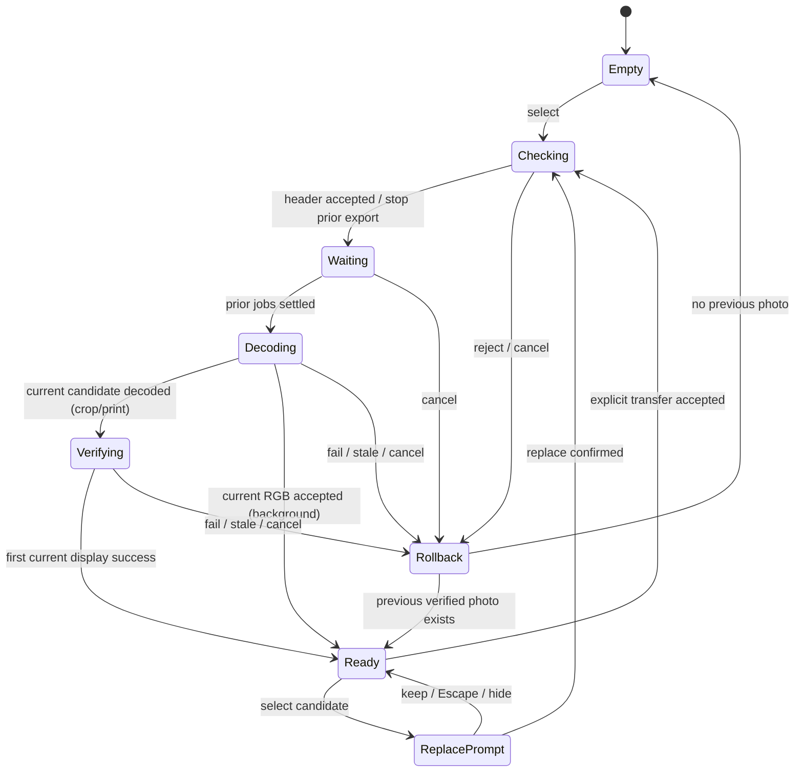
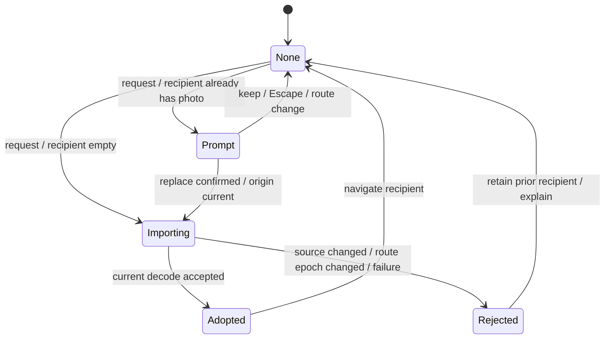

# Image Studio の状態機械と受入契約

2026-11-04。利用者指定「ステートマシンをちゃんと定義してから問題ないか決定」に基づく。
これは本体のinterfaceとして守る契約。遷移図があること、単一路径の成功、既存testの成功だけで全体合格にしない。
既存実装との対応と不足を末尾で区別する。新しい状態管理ライブラリや統合storeの導入を要求しない。

## 1. 状態の所有者

アプリ全体を `S = (route, input[editor], background, export[editor,slot], transfer, gate)` の積として扱う。
写真・結果・revision・候補・leaseは拡張状態のデータ。全組合せを一つのenumへ展開しない。

| Module | Interfaceが所有する状態・効果 | 実装 |
|---|---|---|
| Root | route、工程間受け渡しの同意と採用、navigation epoch | `web/src/Root.tsx` |
| 写真入力 | 候補の検査・decode・表示確認・旧写真へのrollback | `App.tsx`、`background/BackgroundEditor.tsx` |
| Background session | 写真/model/mask/resultの所有、推論開始・停止・close | `background/session.mjs`、`inference-operation.mjs` |
| Export | 入力pin、1job、cancel intent、terminal確認、保存可能性 | `export-job.mjs`、`export/useCropSave.ts` |
| Transfer origin | 下流の元画像有効性の推移的判定 | `App.tsx`の`PhotoTransfer.isCurrent`、`BackgroundEditor.tsx` |
| Shared admission | 全editorの重い処理に対するlease、子Worker、停止失敗時のblock | `worker-gate.mjs`、`imageWorkGate.ts` |

このseamでは、呼出側はrequestと結果を扱う。Worker終了を待つ責務やrevisionの比較を各buttonへ複製しない。
表示`phase`は推論の進行表示であり、admission・結果validity・resource寿命の代用にはしない。
`phase=idle`と`busy=true`は開始/完了の通知途中にあり得る。`hasResult=true`も処理中の旧有効結果と共存し得る。

## 2. データと不変条件

| ID | 契約 |
|---|---|
| I01 | route変更はeditorの破棄ではない。各写真・設定・作成済みファイルを保持する。route変更だけで自動transferしない |
| I02 | 未採用candidateの失敗/取消は旧写真を破壊しない。crop/printでは最初の可視表示成功まで旧verified写真をrollback用に保持する。採用途中で無効化された旧保存ファイルの復活までは保証しない |
| I03 | 推論contextは`(inputId, inferenceRevision, modelVersion, rgbAssetId, refine)`。現在contextとactive tokenの両方が一致した場合だけcommitできる |
| I04 | HR maskは同一`rgbAssetId`と`modelVersion`のみ再利用可。refine切替では保持、写真/model変更・closeでは解放する。mask有効と最終result有効は別 |
| I05 | 編集/取消/pagehide後の古い完了は現在の写真・結果・保存link・routeを更新できない。errorも古い所有者から現在へ伝播させない |
| I06 | cancel要求は終了成功ではない。停止待ち中は重い新jobを受理せず、lease/input pinを終了確認前に再利用しない |
| I07 | 停止を確認できなければblocked。通常の再試行で再開せず、再読込等でsessionを再生成する。成功した「中止」と表示しない |
| I08 | 保存/transferには現在のsource key・出力options・originの一致が必要。DOM render/effectの更新前でもdownloadの開始時に再確認する |
| I09 | crop PNG、用紙PNG、用紙PDFは別slot。形式表示だけの切替で他slotを失効させない。用紙変更は用紙slot、写真/寸法/framing変更は依存するslotを失効させる |
| I10 | transfer先に写真があれば置換同意が必要。取消は両工程を保持。採用前にsource validityとnavigation epochを再確認する |
| I11 | global gateは親pipelineを一つだけadmitし、その親の子Workerも一つだけ。親release要求後も子の終了までは枠を空けない。古いleaseは新ownerを解放/blockできない |
| I12 | close要求で新操作を同期的に拒否する。close Promiseを共有し、完了/失敗確認までを区別する。`snapshot.closed=true`だけでは解放完了を意味しない |

安全性はI01〜I12。終了可能性は、完了または停止応答/期限切れによるblockへ達すること。
mock Promiseが解決するtestだけでは、実Worker/GPUの終了可能性を証明しない。

## 3. 画面と写真入力

`route ∈ {home, background, crop, print}`。routeと各editorの状態は独立。
photo inputは以下の状態を持つ。backgroundはdecode済みRGB採用で完了し、crop/printは別途可視表示を検証する。

- `Checking`はPNG/JPEG境界・寸法等を検査。header拒否前に旧結果を退役させない。
- `Waiting`中の新しい候補はgenerationを進め、旧待機が終わっても古いdecodeを開始させない。
- `Verifying`中は保存不可。古いload/errorイベントはpreview IDで無視する。
- 図のRollbackは効果を示す論理状態であり、Reactに新しいstate値を追加する指示ではない。
- backgroundは別input実装。crop/printの`Waiting`/`Verifying`契約を実装済みと自動継承しない。

## 4. Background session

上位状態は `Open / Closing / ClosedConfirmed / ClosedUnconfirmed`。
Open内のadmission状態は `Available / Running / Stopping / Blocked`。
`ClosedConfirmed/Unconfirmed`はPromiseの結果を含む論理状態であり、既存booleanだけから決めない。
Available内のdata状態は `Empty / Photo / Mask / Result`、保存slotは第5節で独立管理する。

| ID | from / event / guard | to / 効果 |
|---|---|---|
| B01 | Available / setPhoto / RGB検査成功 | Photo、revision更新、旧mask/result/export失効。無効入力なら旧状態を維持 |
| B02 | Available / setModel / known ID・変更あり | 写真保持、model/defaultRefine更新、mask/result/export失効。同一IDはno-op |
| B03 | Available / setRefine / 対応model・boolean変更 | mask保持、result/export失効、revision更新。同値はno-op |
| B04 | Available / run / 写真あり・gate取得成功 | Running、context/token固定、重い処理を開始。gate取得不可なら処理なしで拒否 |
| B05 | Running / complete / contextとtokenが現在・子資源終了 | Resultをcommit、Availableへ。最終cutoutがあるだけではまだdownload不可 |
| B06 | Running / complete / 古いcontextまたは取消token | stale/cancelled、commitなし。古い完了は新jobを取消できない |
| B07 | Running / ordinary failure / 停止確認成功 | Available、写真と一致するmask保持、安全なerror、明示再試行可能 |
| B08 | Running / cancel | Stopping、token失効、owned資源の停止を待つ。新model/photo/refine/run/save不可 |
| B09 | Stopping / all owned resources terminal | Available、未commit結果を破棄。写真・一致するmaskは保持 |
| B10 | Running/Stopping / stop failed | Blocked、再利用不可・再読込案内 |
| B11 | Open / close | Closing、新操作を同期拒否、token失効、全owned資源停止、mask/result/photo/export解放 |
| B12 | Closing / all close work settled | ClosedConfirmedまたはClosedUnconfirmed。再closeは同じPromise。失敗を成功扱いしない |

Running内部の進行は `model-load(HR) → inference(HR) → releasing → [trimap → model-load(Matte) → inference(Matte) → releasing] → foreground → commit`。
保持maskがあればHR部分を飛ばし、refine=falseならMatte部分を飛ばす。軽量modelはMatteなし。
各await境界の取消/古い完了はB06/B08へ合流する。model loadの通信/検証/cacheエラーはB07/B10で扱う。

UIの同意は `NoIntent → Inspecting → Confirmable → Rechecking → Started`。
取消/非active化/pagehideでIntentを失効。開始直前にsession owner/epoch/active/blocked/closedを再確認する。
cache見積りが増加・容量不足ならConfirmableへ戻して再確認する。cache照会だけで推論開始しない。

## 5. 保存jobと保存可能条件

| ID | from / event | to / 効果 |
|---|---|---|
| E01 | Idle / generate / source・options・origin有効・gate可 | Encoding、sourceをpin、options/keyをsnapshot |
| E02 | Encoding / complete / token/key/origin一致・出力検査成功 | Ready slotを公開。PNG/PDF byte・MIME・寸法・filename検査を通す |
| E03 | Encoding / input/options revision changed | 結果はstale、保存不可。必要な旧jobのterminalを待つ |
| E04 | Encoding / cancel | Cancelling、abort intent、terminalまでpin/占有を保持 |
| E05 | Cancelling / terminal confirmed | Idle、cancelled。遅延fileは公開しない |
| E06 | Encoding/Cancelling / stop failed | Blocked、再実行不可・再読込案内。他の有効slotを無条件消去しない |
| E07 | Ready / dependency changes | 当該slot失効、link解除。表示形式だけ変更ならslot維持 |
| E08 | Ready / download or transfer | 下記predicateをその時点で再評価。有効なら開始、失効なら拒否・作り直し案内 |

`canSave(slot) = readyFile(slot) ∧ sameSourceKey ∧ sameOutputOptions ∧ originCurrent ∧ linkOwned`。
UIがその操作中に禁じるbusy/blocked/closedも操作guardへ適用する。
背景の透明PNGはbackground color変更だけではbyte依存が変わらないが、白背景handoffのoriginは失効させる。
`hasPhoto`、`hasResult`、`phase=idle`、画面に古いlinkがあることのどれも、単独では保存可能性を意味しない。

## 6. 工程間受け渡し

`importPhoto`の採用と可視表示検証は別段階。採用後の表示失敗は写真入力のrollbackへ移る。
背景→crop→printは、直近だけでなく上流の`isCurrent()`を推移的に検査する。
上流変更時は下流プレビューを見せ続けてもよいが、保存/再transferを拒否し、明示更新を要求する。
独立して読み込んだprint写真はcropの編集に依存させない。

## 7. 実装照合と受入方法

まず契約上の不変条件とevent列からtestを選び、結果を照合する。test名の存在だけでは合格にしない。
必要な場合だけ既存の責任Moduleを修正し、新しい状態管理Moduleを重ねない。

| 契約 | 主な既存の検証先 | 今回の判定対象 |
|---|---|---|
| B01〜B12 / I03〜I07,I12 | `tests/background_session.test.mjs`、`test_inference_operation.mjs` | 写真/model/refine/取消/停止失敗/古い完了/close |
| E01〜E08 / I08,I09 | `tests/test_export_job.mjs`、`web/tests/useCropSave.test.tsx` | source pin・取消terminal・即時失効・独立slot |
| I11 | `tests/test_worker_gate.mjs`、`test_inference_pipeline_gate.mjs` | 親子lease・遅延release・block |
| I01,I02 / 写真入力 | `web/tests/App.test.tsx` | 非active化、header/decode/可視確認失敗、rollback |
| I05,I08,I10 / transfer | `web/tests/handoff.test.tsx`、`backgroundEditor.test.tsx` | 同意取消、source変更中のdecode、下流失効 |
| 同意・pagehide | `web/tests/backgroundEditor.test.tsx` | 許可前実行なし、見積り再確認、古いIntent拒否 |

今回の評価は「定義→既存実装との対応→test実行→未検証遷移の明示」の順。
上表は網羅済み宣言ではない。全await境界のevent順序、全moduleのclose失敗組合せ、route/transfer/inputの積の到達可能性は個別に確認する。
実端末・Worker停止・ブラウザpage lifecycle・人の操作は別の証拠が必要。
単一路径のnative確認は `validation/2026-11-04-clean-paired-gpu-full-journey.json` を参照。
これは四構成/全遷移/実機/実印刷/一般画質の合格を示さない。

## 8. 定義後の検査で見つかった差分（2026-11-04）

I05のsession通知について、`createSession(setState)`が旧ownerを識別しないことを確認した。
runtime変更後に新しい写真/sessionを採用してから旧sessionの`closed/blocked/busy/stopping`通知が届く列で、
新しい実行buttonがdisabledになるREDを得た。通知callbackを作成元ownerと`session.current`が一致するときだけ受理するよう、
既存BackgroundEditor内の受け口を修正した。初期同期通知は無視し、採用後に既存`getState()`で状態を取得する。
追加の状態管理Module/依存/公開interfaceはない。

- RED: runtime変更→新session→旧通知で失敗（`retired-session-red.log`）。
- GREEN: 同じ列で成功（`retired-session-green.log`）。pagehide→新sessionの列も回帰対象へ追加。
- 定義後の初期照合: domain5file48test、UI5file141test成功。これは修正前の既存testの結果。
- 修正後の全UI/type/build結果は対応validation記録に固定する。全積状態/全awaitの網羅はまだ主張しない。

未閉鎖の遷移検証: close失敗と新session生成の競合全組合せ、全推論awaitのcancel/error順序、
route変更とtransferの可視確認中rollback、実BFCache/pageshowでの再開、実Worker停止不能時の挙動。
既存の個別testがある項目もあり、必要event列への対応を確認せず「網羅済み」にしない。
本体修正によりsource13固定候補のnative結果を修正後へ流用せず、再固定・影響範囲の受入を別途行う。

### 追加の入口・取消完了の照合

写真選択より先にモデルを選ぶと、別の`createSession(setState)`経路を通っていた。
前回の写真入口だけの修正ではI05を満たさない。`model-first → runtime変更/pagehide → 新session → 旧通知`で2REDを確認した。
両入口はBackgroundEditor内の`ensureSession()`を使い、同じowner付きcallbackを生成する。新しいModuleではなく既存責務の共通化。
`photo/model × runtime変更/pagehide`の4event列を回帰対象とする。

`cancel → 旧run終了 → runtime変更 → 新photo/session → 旧cancel resolve/reject`でも、
旧操作の中止成功/停止失敗案内が新しい画面へ混入する2REDを確認した。
cancel開始時にownerとepochをsnapshotし、完了・失敗の両方で一致を再確認する。
現sessionの本当の停止失敗を無視する修正ではない。既存の中止待ち・停止失敗の回帰も全UIで再検査する。

| 非同期入口 | 現在の更新guard | 判定範囲 |
|---|---|---|
| session callback | 作成元ownerとsession.current | 2入口×2lifecycle回帰 |
| cancel resolve/reject | ownerとepoch | 旧成功/旧失敗回帰 |
| decode採用/失敗 | abortとgeneration、失敗はabortを確認 | 既存photo入力回帰。finallyの待機解消と実BFCacheは別途確認 |
| run/save結果 | epoch、実行後のstate読出しはowner | 既存run/cancel回帰。全await境界の網羅ではない |
| 白背景handoff | owner/epoch/closedとorigin | 既存handoff/cancel回帰 |
| cache照会/削除 | cacheEpoch ticket | 既存pagehideと遅延cache回帰 |
| 実行同意 | intent identity/owner/epoch/active | 既存同意取消/再確認回帰 |

新しいcallbackやawaitを足す際は、この表の所有者・失効event・停止terminalを先に決める。
この表はsource読解と列挙した回帰の対応であり、全状態の形式検証ではない。

### B06/B08〜B12の待機境界の検証（2026-11-04）

実装変更なしで、既存session/serial-inference/operationをinterface越しに検査した。

| 対象event列 | 組合せ | 検査する不変条件 | 結果 |
|---|---:|---|---|
| close要求→元executeが先にcancelled→owned停止がまだpending→close再要求→停止成功 | 1 | closed flagで解放完了としない、同一close Promise、新操作拒否、gate保持、成功後だけ次owner可 | pass |
| 同じ列→停止失敗 | 1 | gateはblocked、新owner不可、停止失敗を成功扱いしない、最終photo/mask/resultなし | pass |
| 各awaitでcontext変更→遅延resolve/reject | 8×2 | 後段requestなし、commit0、stale、停止1回、中間alpha解放、元RGB保持 | pass |
| 各awaitで明示cancel→遅延resolve/reject | 8×2 | 後段requestなし、commit0、cancelled、停止1回、中間alpha解放、元RGB保持 | pass |

8境界はHR prepare/infer/dispose、trimap、Matte prepare/infer/dispose、foreground。
実client/演算の代わりに制御可能な非同期adapterを使い、既存operationとserial-inferenceの連結で検査する。
期待するevent prefixと最終状態を比較し、test名の存在だけで合格にしない。
closeは`background_session.test.mjs`の既存fixtureへ停止待機だけを追加し、共有gateを実際に取得しようとして拒否/再許可を確認した。
domain全665件成功、fail/skip0。既存実装が契約を満たしたのでproduction codeは変更しない。

[検証記録](validation/2026-11-04-state-machine-stop-boundaries.json)。
これは8境界の制御された2event×2完了順序であり、連打/複数回取消/全context項目/全backend/provider/
保持mask分岐/全画像形状の直積や、実Worker停止失敗/GPUdriver/実BFCacheを網羅するものではない。
先行の「全await順序未確認」は、この32列を確認済みとしたうえで残る組合せに限定する。

### Transfer採用後・最初の表示前のorigin失効（I02/I08/I10）

`Importing → Adopted`はdecode採用であり、可視表示の検証完了ではない。
`Verifying → Ready`のguardにも`originCurrent`を要求する。
採用後・表示前に上流が変わったときは `Verifying → Rollback` とし、
候補URLを解放、依存する出力を失効、旧verified写真/ファイル/origin/調整内容へ復帰する。
旧写真がなければEmptyへ戻す。旧保存slotは自動復活させない。
その後の候補の遅延loadはpreview ID不一致で無視する。
既に可視表示成功まで確定した写真は、後から上流が変わってもこのrollbackへ戻さず、
従来のstale preview＋保存拒否＋明示更新で扱う。

既存実装はdecode直後のoriginを確認していたが、`App.displayReady`では確認せず、
最初の表示成功時に保持中の旧写真を解放していた。
crop/print×旧写真あり/なしの4caseでREDを得て、既存`displayReady`にこのguardを追加。
新しいtransfer ModuleやRootの追加storeは不要。4GREENと、Root/実保存hookを使う1integrationを追加した。
このintegrationは独立print写真→候補採用→cropへ戻る→上流framing変更→printで初表示という列。
rollback後に旧印刷写真が保持され、旧URL未解放・候補URL解放・旧保存linkなし・再作成可能を確認する。
初回integrationは印刷route描画を待たずfile inputへ操作したtest不備で失敗し、
実headingを待つよう訂正した後に成功した。app修正のREDとは区別する。

### pagehide/BFCacheの実ブラウザ照合

I01のroute変更と、別documentへ移るnavigationを区別する。
現実装はpagehideで写真・保存link・transfer intentを失効/破棄する。
BFCacheへの格納であっても同じで、pageshow.persisted=trueだから旧写真を復元する仕様ではない。
復帰後はEmptyから写真を選び直して新しい処理を開始できることが契約となる。

2026-11-04の現在通常build sourceId `aecd470d…` 全14file/8174058BをSHA照合し、
GPU無効の使い捨てLinux Chrome containerで実行。実crop PNG354×472/300dpiをnative保存後、
別の同一origin documentへ遷移し、browser backで戻った。
同じメモリ内document IDでpagehide.persisted=true/pageshow.persisted=trueの両方を観測。
復帰後の写真Blob画像0/保存link0、新しい写真選択→実crop生成→新しい保存link1を確認した。
後者は生成/link確認で、2本目のnative保存bytesを取得したとはしない。

初回写真数assertはロゴSVGも数えるharness誤りで失敗。残ったimgがロゴだけであることを実DOMで確認し、
Blob-source画像だけを対象に訂正した。同じ生存browser/documentで再開し、navigation/初回推論を再実行していない。
アプリの不具合や「一時的に写真が復活した」とは扱わない。
既存guard内で終了し、owned profile/app/一時DL22888448Bを整理、browser/proxy/tunnel/containerを停止、Gufo0を維持した。

[実BFCacheと復帰の証拠](validation/2026-11-04-current-manual-real-bfcache.json)。
これはmanual cropのidle navigationに限る。背景session、処理途中、複数往復、別browser、
実Worker停止不能やBFCacheを使わない復帰は別の検証。CDP観測コードは本体へ同梱しない。

### 契約と修正のソース固定

source14は状態契約・owner/epochと初表示rollbackの修正・回帰を含む702fileを固定。
復元先scripts24/domain665/UI317/型/buildを再検査し、元source全SHA不変を確認した。
既存依存を同一lock/version/integrity/resolved metadataの照合後に移して再利用した検査で、fresh installではない。
現通常版14fileとのbyte一致、捕捉入力で設定付き93資産不変、既定配置2回の全111file一致を確認。
[復元証拠](validation/2026-11-04-source14-restored-state-machine-build.json)。
捕捉source案内は旧source13へ向くため最終source14配布bindingは未完。
状態遷移の新しいnative受入や実配信・人/実機/印刷の合格へ置換しない。

### source14 configured候補の実navigation・session再生成

7677/c2bd固定候補でMODNet CPU→GPU→別document→back→新写真/新session→CPUを実保存。
3PNGは各既存backend基準とbyte一致、旧写真/保存link0から再実行へ復帰した。
このbackではメモリ内probeがなく新documentであり、BFCache復帰とは判定しない。
先行manualで確認したBFCache復帰と、今回のconfigured再読込復帰を区別する。
旧sessionの遅延通知が同じDOMの新sessionへ入る競合そのもののnative証明ではなく、
そのI05競合は先行の所有者別DOM回帰、今回は実資源解放/再生成と保存の証拠である。
fixtureだけのfavicon404で旧全GET200assertが失敗したため、実logを調べてexact path/statusを別枠へ記録。
アプリ/モデル通信の失敗を許容する変更ではない。browser errors記録は空、ZIP取得は3実行で1回。
[同候補の検証範囲](validation/2026-11-04-source14-modnet-native-lifecycle.json)。

### source14 GPU HR/Matte→crop→printのnative正常経路

7677/c2bdでGPU HR/MatteのPNG保存から白背景handoff、crop、A4 PNG/PDF、背景復帰まで実行した。
初表示origin再検査を含む正常採用経路で、各exportは旧候補と全byte一致。
背景復帰時に元の背景PNG linkを保持し、390pxの6状態でoverflow/alertなし。
PDF埋込RGBとPNGの全26,099,520B一致、300dpi PNG・1page PDF geometryを別parserで確認した。
[固定候補GPU通しの証拠](validation/2026-11-04-source14-gpu-full-journey.json)。
これは正常1経路であり、表示前上流失効のnative再現や全競合の証明ではない。
そのguard/rollbackは先行4DOMケースとRoot統合のRED/GREEN、今回の正常nativeを別に保持する。

### source14 CPU HR/Matteと四構成の通常native対応

同じ7677/c2bdのCPU HR/MatteもGPU無効・最大2threads/8GiB枠で実保存し、
白背景handoff→crop→A4 PNG/PDF→背景復帰を完了した。透過PNGと3派生出力は各旧CPU基準とbyte一致。
両HR backendのPDF内RGBは各PNGと全26,099,520B一致。CPU注意書きを実表示、物理RAM8GiB端末対応は主張しない。
[CPU journey](validation/2026-11-04-source14-cpu-full-journey.json)、[四構成](validation/2026-11-04-source14-four-choice-native.json)。
138実行sourceのarchive内manifestを照合すると変更はApp/BackgroundEditorのみで、
他136sourceと両npm manifest/lockは不変。92生成non-notice資産の不変性は最終配布bindingの別証拠で確認済み。
[変更影響](validation/2026-11-04-source14-runtime-change-impact.json)に基づき、
既存の計算/通信protocolの証拠を維持し、UIへ同じ入力が渡るか・資源枠・所有権/失効は現candidateで別に検証する。
source一致だけで一般品質/全shape/全device/全遷移を合格にしない。

### source14 GPU補正表示中の中止と保持mask再試行

同じ7677/c2bdで、実UIの「輪郭を補正しています」表示を待ち、中止操作から終了案内を確認。
同写真Blob URL/寸法保持・保存0・alert0、再実行actionが補正のみになることを確認した。
明示同意後の再試行ではHR進捗再表示なし、trimap/Matte/前景色/PNGを1秒pollで観測し、
最終PNGが通常GPU基準と全byte一致した。最初のZIP2GET/子Worker1GET/cache140を維持。
[実取消・再試行](validation/2026-11-04-source14-gpu-matte-cancel-retry.json)。
B08→B09→B04/B05とI04/I05/I06のこの実操作列の証拠で、
全失敗/連打/別ownerや正確なGPU kernel中断位置・intercepted Worker commandの証明ではない。
32await失効/取消の制御adapter回帰、source不変なprotocol証拠、今回の実UI/保存/資源証拠を分けて保持する。

### 写真読込中のruntime退役・pagehide後の遅延終端

I05のdecode経路へruntime切替/pagehide×遅延resolve/rejectの4列を追加した。旧AbortSignalが失効し、遅延成功がsession/写真を採用せず、遅延失敗がalertを公開しないことを確認。旧decode終端後にinputが利用可能となり、新写真選択→PNG作成linkへ進める。現実装のまま4件成功、全UI27file/321件と型検査成功。終端前の新decode受理や実Worker停止/BFCacheを証明するtestではない。

[制御decode回帰](validation/2026-11-04-source14-retired-decode-contract.json)。実行sourceはsource14 archiveとbyte一致、新test/今回文書は捕捉後の追加。HF pair/private状態は変更しない。

### mainの遅延背景runtime失敗と手動editorの寿命

mainは起動時にRootを描画し、背景runtimeの非同期import成功/失敗で同じRootを再renderする。現source14でJS応答をcrop PNG作成まで保留→404とした実browserでは、同document/写真/保存linkを保持しnative保存・新link再作成できた。I01/I02/I08のこの操作列へ対応付ける。dynamic importを背景buttonで開始するものと扱わない。

[制御native](validation/2026-11-04-source14-runtime-import-failure-native.json)。実deployment切替やすべての非同期import、失敗タイミングへの網羅宣言ではない。
